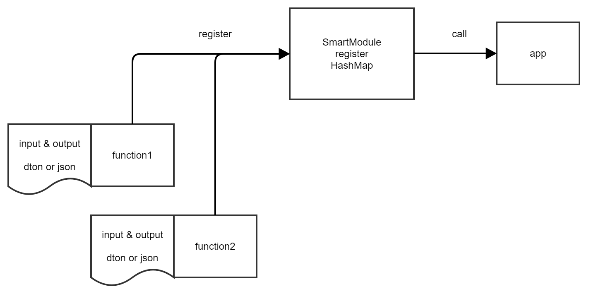

# smcore

SmartModule Core Library provides a shared registry for SmartModule handlers,
dispatches calls using the `$usage` field, and supplies runtime utilities.

## SmartModule Register HashMap



## Public API by Module

Import the public entry points with:

```rust
use smcore::{smh, smu, ISmCoreSupport};
```

The implementation modules are private. Their supported functions are exposed
through the `smh` and `smu` singleton values and the `ISmCoreSupport` trait.
The signatures below omit the singleton methods' `&self` receiver.
`SmDtonBuffer` and `SmDtonMap` come from `smdton`; `JsonValue` comes from `json`.

### Registry and Dispatch: `smcore::smh`

| Function | Description |
| --- | --- |
| `smh.register(define: SmDtonBuffer, method: fn(&SmDtonBuffer) -> SmDtonBuffer) -> bool` | Register a handler using a DTON definition. Return `false` if `$usage` is missing or empty. Registering the same name replaces its previous handler. |
| `smh.register_by_json(define: &JsonValue, method: fn(&SmDtonBuffer) -> SmDtonBuffer) -> bool` | Convert a JSON definition to DTON and register its handler, with the same validation as `register`. |
| `smh.call(input: SmDtonBuffer) -> SmDtonBuffer` | Dispatch the input to the handler named by its `$usage` field and return the handler's result. |

`call` returns an empty buffer when `$usage` is missing, or when no matching
handler or fallback is available. Registering a handler named `smker.callsm`
enables fallback dispatch for unknown names; the fallback receives the original
input. When panic catching is enabled, panics from directly matched handlers are
returned as DTON objects containing `$panic`. The fallback is called directly.

### Runtime Utilities: `smcore::smu`

| Function | Description |
| --- | --- |
| `smu.build_key(pre: &str, sub: &str) -> String` | Join a prefix and suffix with a period, producing `pre.sub`. |
| `smu.build_buffer(define: &JsonValue) -> SmDtonBuffer` | Build a DTON buffer from a JSON value. |
| `smu.new_sm_map<'a>(value: &'a str) -> SmDtonMap<'a>` | Create a DTON map with `$usage` set to `value`. |
| `smu.get_string(jsn: &JsonValue, key: &str) -> Option<String>` | Read a JSON string property as an owned string; return `None` for a missing or non-string property. |
| `smu.set_wasm(wasm_type: i32, support: Option<Box<dyn ISmCoreSupport>>)` | Set the runtime type and support provider. A type below `10` with `None` installs the built-in Rust provider and enables panic catching. |
| `smu.wasm_type() -> i32` | Return the configured runtime type. Types `0..=9` represent Rust; types `10..=19` represent web Wasm. |
| `smu.set_debug(in_debug: bool)` | Enable or disable debug logging of directly matched calls and their input/output. |
| `smu.is_debug() -> bool` | Return whether debug logging is enabled. |
| `smu.has_support() -> bool` | Return whether a runtime support provider is installed. |
| `smu.get_current_ms() -> u128` | Ask the provider for the current time in milliseconds; return `0` if no provider is installed. |
| `smu.log(txt: &str)` | Send a message to the provider; do nothing if no provider is installed. |

Initially, the runtime type is `0`, no provider is installed, and debug logging
and panic catching are disabled. The built-in Rust provider reports milliseconds
since the Unix epoch and logs to standard error for runtime type `1`, or standard
output otherwise. Subsequent `set_wasm` calls that select another configuration
leave the panic-catching flag unchanged.

### Host Integration: `smcore::ISmCoreSupport`

Implement this `Send + Sync` trait to supply host logging and time services, then
pass the implementation to `smu.set_wasm` as `Some(Box::new(provider))`.

| Function | Description |
| --- | --- |
| `sm_log(&self, txt: &str)` | Write a log message through the host. |
| `get_current_ms(&self) -> u128` | Return the current time in milliseconds from the host. |

## Built-in SmartModule Functions

These functions are invoked through `smh.call` using their `$usage` name.
The kernel registers its built-in handler during the first registration;
calling `smh.call` alone does not initialize the registry.

| Module | Function | `$usage` | Description |
| --- | --- | --- | --- |
| `smker` | `get.all` | `smker.get.all` | Return a DTON object mapping registered handler names to their definitions. |

## Example

```rust
use json::object;
use smcore::{smh, smu};
use smdton::SmDtonBuffer;

fn echo(input: &SmDtonBuffer) -> SmDtonBuffer {
    input.clone()
}

fn main() {
    smu.set_wasm(0, None);

    let definition = object! { "$usage" => "example.echo" };
    assert!(smh.register_by_json(&definition, echo));

    let request = object! {
        "$usage" => "example.echo",
        "message" => "Hello, SmartModule!"
    };
    let _response = smh.call(smu.build_buffer(&request));

    let list_request = smu.new_sm_map("smker.get.all").build();
    let _definitions = smh.call(list_request);
}
```

